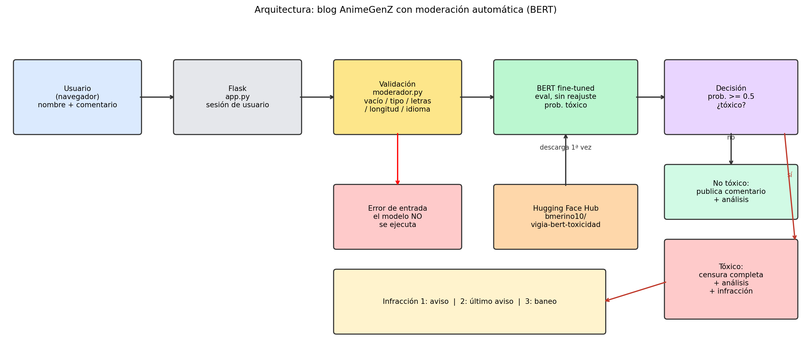

# 🌸 Senpai Notes: blog con moderación automática de comentarios (BERT)

Prototipo funcional del Proyecto Integrador de *Desarrollo de Soluciones Inteligentes*
(Universidad Bernardo O'Higgins, 2026-S2, paralelo D03).
**Equipo:** Branco Merino y Matías Díaz.

## 1. Problema, usuario y alcance

Los blogs y comunidades en línea reciben comentarios ofensivos que un moderador humano
no alcanza a revisar uno por uno. Este prototipo simula un blog de anime donde cada
comentario es analizado por un modelo BERT **antes de publicarse**:

- Si es tóxico, el mensaje se **censura completo**, se muestra el **análisis**
  (probabilidad, confianza, umbral) y se cuenta una infracción al usuario.
- En la 2ª infracción se muestra una **alerta de último aviso**; en la 3ª el usuario
  queda **baneado** y no puede comentar.

**Usuario objetivo:** moderador/a de una comunidad en línea.
**Decisión que apoya:** priorizar y filtrar comentarios potencialmente tóxicos.
**Fuera de alcance:** autenticación real, base de datos persistente, comentarios en español.

## 2. Datos

| Aspecto | Detalle |
|---|---|
| Dataset | [Civil Comments](https://huggingface.co/datasets/google/civil_comments) (`google/civil_comments`) |
| Licencia | **COMPLETAR** según la ficha del dataset en Hugging Face |
| Muestra | 50.000 filas del split `train` (semilla 42) |
| Etiqueta | `toxico = 1` si `toxicity >= 0.5` (decisión del equipo, no oficial) |
| Limpieza | Sin vacíos ni inválidos; 75 textos repetidos eliminados → 49.925 filas (92,09 % no tóxicos / 7,91 % tóxicos) |
| Partición | Estratificada 70/15/15: 34.947 entrenamiento, 7.489 validación, 7.489 prueba, sin textos compartidos |

Detalle completo en `notebooks/` (T04).

## 3. Técnica y selección del modelo

Se compararon tres enfoques sobre el **mismo conjunto de prueba** (7.489 comentarios):

| Modelo | Accuracy | F1 macro | F1 tóxicos |
|---|---|---|---|
| Baseline mayoritario (siempre "no tóxico") | 0.9210 | 0.4794 | 0.0000 |
| TF-IDF + Regresión Logística | 0.8896 | 0.7082 | 0.4782 |
| **BERT** (`bert-base-uncased` ajustado) | **0.9424** | **0.8043** | **0.6399** |

El baseline tiene alta *accuracy* pero no detecta ningún comentario tóxico, por eso se
eligió **F1 macro** como métrica principal. **Se seleccionó BERT** por mayor F1 macro y
mayor F1 en la clase tóxica.

- Modelo publicado: https://huggingface.co/bmerino10/vigia-bert-toxicidad
- Entrenamiento: 5 épocas, lr 2e-5, longitud máx. 256, early stopping, GPU T4 (Colab).

## 4. Arquitectura



Flujo: el usuario escribe un comentario en el blog (Flask), se **valida** la entrada
(si es inválida se muestra un error y el modelo no se ejecuta), BERT se descarga una
vez desde Hugging Face y calcula la probabilidad de toxicidad. Si es `>= 0.5` el
comentario se **censura completo**, se muestra el análisis y se suma una infracción
(1: aviso, 2: último aviso, 3: baneo). Si no, se publica con su análisis.

| Componente | Archivo |
|---|---|
| Aplicación web (Flask): login, comentarios, censura, infracciones | `app.py` |
| Carga de BERT, validación de entradas, inferencia | `moderador.py` |
| Interfaz del blog | `templates/index.html` |
| Pruebas automáticas | `pruebas/test_modelo.py` |
| CI (GitHub Actions) | `.github/workflows/ci.yml` |

El modelo **no está en este repositorio**: se descarga desde Hugging Face la primera vez
(~440 MB) y queda en caché.

## 5. Estructura del repositorio

```
├── app.py
├── moderador.py
├── requirements.txt
├── README.md
├── LICENSE
├── templates/index.html
├── pruebas/test_modelo.py
├── evidencias/            (resultados de pruebas, capturas, análisis de errores)
├── notebooks/             (T03 y T04 en Colab)
├── .devcontainer/devcontainer.json
└── .github/workflows/ci.yml
```

## 6. Cómo ejecutar

### Opción A: GitHub Codespaces (recomendada)

1. En este repositorio: **Code → Codespaces → Create codespace on main**. Espera 2 a 5 minutos.
2. Abre la terminal del Codespace (☰ → Terminal → New Terminal).
3. Si el instalador automático no terminó o falló, ejecuta:
   ```
   pip install torch --index-url https://download.pytorch.org/whl/cpu
   pip install -r requirements.txt
   ```
4. Arranca el blog:
   ```
   python app.py
   ```
   La primera vez descarga el modelo. Espera a ver `Running on http://127.0.0.1:5000`.
5. En la pestaña **PORTS**, abre el puerto **5000** (icono 🌐). Si no aparece, **Add Port → 5000**.
   Si el navegador no puede acceder: clic derecho en el puerto → **Port Visibility → Public**.

### Opción B: en tu computador

Requiere Python 3.10+.
```
git clone https://github.com/merinobranco10/blog-toxicidad-bert.git
cd blog-toxicidad-bert
pip install -r requirements.txt
python app.py
```
Abre http://localhost:5000

### Opción C: Google Colab

```python
!pip -q install flask transformers torch
!git clone https://github.com/merinobranco10/blog-toxicidad-bert.git
%cd blog-toxicidad-bert
import threading
from google.colab import output
import app
threading.Thread(target=lambda: app.app.run(port=5000)).start()
output.serve_kernel_port_as_window(5000)
```

### Variables opcionales

| Variable | Uso | Por defecto |
|---|---|---|
| `MODEL_ID` | Modelo de Hugging Face | `bmerino10/vigia-bert-toxicidad` |
| `SECRET_KEY` | Clave de sesión de Flask | valor local de demostración |

No se requieren tokens ni credenciales (el modelo es público).

## 7. Guion de demostración

1. Ingresa un nombre de usuario (ej. `luffy_fan`).
2. `Thanks for the article, it was really helpful.` → se publica normal.
3. `You are a complete idiot and nobody wants you here.` → censura + análisis + infracción 1/3.
4. Otro insulto en inglés → **último aviso** (2/3).
5. Un tercer insulto → **baneo** y formulario deshabilitado.
6. Comentario vacío → error de validación (el modelo no se ejecuta).
7. `!!! 123 ???` → error: no contiene letras.
8. Un texto en español con varias palabras → advertencia de idioma.

## 8. Validación y pruebas

**Automáticas** (`pruebas/test_modelo.py`, se ejecutan en GitHub Actions en cada push):
caso válido neutro, caso válido tóxico, entrada vacía, sin letras, nula y texto en español
(advertencia). Resultados en `evidencias/resultados_ci.json`.

Para ejecutarlas localmente: `python pruebas/test_modelo.py`

**Manuales:** capturas en `evidencias/`.
**Análisis de errores:** `evidencias/analisis_errores.md`.
**Métricas del modelo:** sección 3 y `notebooks/`.

## 9. Riesgos, limitaciones y ética

- **Solo inglés.** En español el modelo no es fiable. Ejemplo observado: la palabra
  aislada "estupido" fue clasificada como no tóxica (0,0 %).
- **Falsos positivos:** con precisión de 0,63 en la clase tóxica, aproximadamente 1 de cada 3
  comentarios censurados podría ser legítimo.
- **Falsos negativos:** con recall de 0,65, cerca de 1 de cada 3 comentarios tóxicos pasa sin censura.
- **Umbral arbitrario (0,5)** y posible **sesgo** heredado de Civil Comments (no se auditó).
- **Ironía y contexto:** el modelo puede fallar con sarcasmo o citas.
- **Baneo de demostración:** no hay autenticación real; el usuario es solo un nombre
  escrito y las infracciones viven en memoria (se pierden al reiniciar la app).
- **Privacidad:** no se guardan datos personales ni se persisten comentarios.
- **Uso responsable:** apoyo a la moderación, **no** reemplaza la revisión humana ni debe
  usarse para sancionar personas reales sin supervisión.
- **Licencias:** código bajo MIT (ver `LICENSE`); modelo base `bert-base-uncased` (Apache-2.0);
  dataset Civil Comments (licencia en la sección 2).

## 10. Enlaces

- Modelo: https://huggingface.co/bmerino10/vigia-bert-toxicidad
- Notebooks: carpeta `notebooks/` (ver su README)

## 11. Declaración de uso de IA generativa

| Aspecto | Detalle |
|---|---|
| Herramientas | Claude (Anthropic) y ChatGPT (OpenAI) |
| Finalidad | Estructurar y redactar código, documentación y guion de pruebas |
| Componentes afectados | Notebooks T03/T04, `app.py`, `moderador.py`, plantilla HTML, README |
| Verificación | El equipo ejecutó los notebooks, la app y las pruebas; las métricas provienen de ejecuciones reales |

El equipo es responsable de todo el contenido entregado.
